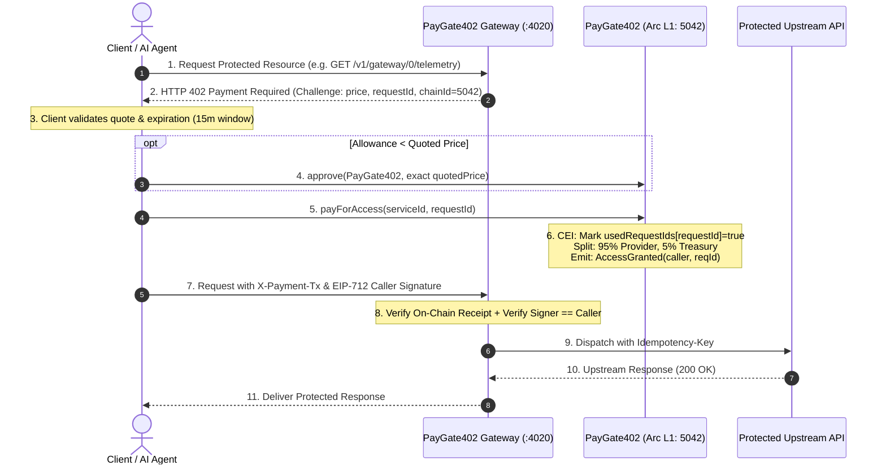
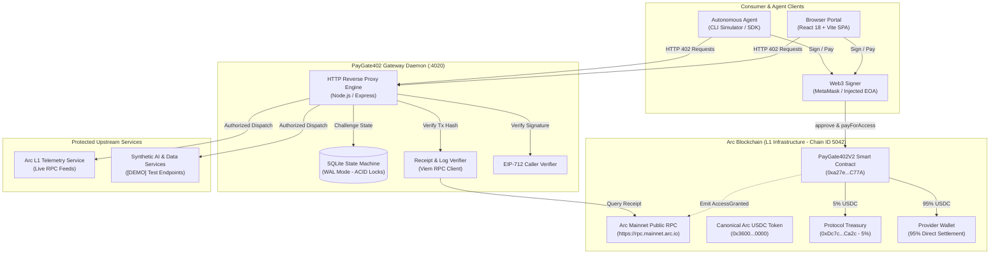

# PayGate402

> HTTP 402 payments for APIs, powered by Arc.

[](contracts/)
[](tsconfig.json)
[](https://explorer.arc.io/address/0xa27e390CC82793911D805D4cB3E0c50F2117C77A)
[](https://studio.arc.io/app/32f7ab57-a1ca-4bc8-a29b-86f59668911c)
[](LICENSE)

PayGate402 is an on-chain micropayment protocol, reverse proxy gateway, and developer portal built for the [Arc Network](https://arc.io). Inspired by the standard **HTTP 402 Payment Required** status code, PayGate402 enables software services and autonomous AI agents to purchase paid API access on a per-call basis using real USDC—with zero monthly subscriptions, API key custody, or pre-funded SaaS credit balances.

---

## 1. Project Overview

PayGate402 implements a trust-minimized, per-call settlement rail where payment settlement and data delivery occur in direct cryptographic succession:

- **HTTP 402 Pay-Per-Call:** Service providers define endpoints with per-request pricing. Unauthenticated requests trigger an HTTP 402 challenge ticket rather than a static paywall or login prompt.
- **Autonomous AI Agent Friendly:** AI agents can discover services, validate quoted prices, authorize exact-amount USDC transfers on Arc Mainnet, and unlock protected data payloads without human billing intervention.
- **Automatic 95/5 Revenue Split:** Smart contracts enforce an immutable 95% revenue distribution directly to the service provider and 5% to the protocol treasury on every call.
- **Cinematic Meridian Experience:** A full-viewport, 1280×800-optimized landing hero with dynamic crown clearance above the subject portrait, paired with a persistent application header providing instant navigation across Explore, My Services, Transactions, Developer Docs, and Agent CLI.

---

## 2. Live Links & Release Status

| Resource | URL / Reference | Status |
| :--- | :--- | :---: |
| **Production Web Application** | [`https://paygate402-kappa.vercel.app`](https://paygate402-kappa.vercel.app) | **Live** |
| **Public GitHub Repository** | [`https://github.com/JimmyOgb/PayGate402`](https://github.com/JimmyOgb/PayGate402) | **Public** |
| **Previous Published Release** | `v2.1.0-meridian` | **Published** |
| **Current Release Candidate** | `v2.2.0` (`v2.2.0-meridian-mainnet`) | **Release Candidate** |
| **Arc Studio Project** | [`https://studio.arc.io/app/32f7ab57-a1ca-4bc8-a29b-86f59668911c`](https://studio.arc.io/app/32f7ab57-a1ca-4bc8-a29b-86f59668911c) | **Verified** |

> *Release Note:* `v2.2.0` represents the current Arc Mainnet-only production hardening release candidate. The annotated tag `v2.2.0-meridian-mainnet` is prepared and verified locally before remote publication.

---

## 3. Arc Mainnet Configuration

Production runtime is strictly locked to **Arc Mainnet (Chain ID `5042`)**. Any connected wallet operating on an unsupported network is automatically flagged with an interactive warning prompt requesting a switch to Arc Mainnet before any transaction can proceed.

| Parameter | Authoritative Value | Verification Link |
| :--- | :--- | :--- |
| **Network Name** | Arc Mainnet | [Arc Documentation](https://arc.io) |
| **Chain ID** | `5042` | Native L1 Execution |
| **RPC Endpoint** | `https://rpc.mainnet.arc.io` | Official Public RPC |
| **PayGate402 Contract** | `0xa27e390CC82793911D805D4cB3E0c50F2117C77A` | [ArcScan Contract](https://explorer.arc.io/address/0xa27e390CC82793911D805D4cB3E0c50F2117C77A) |
| **Canonical USDC Token** | `0x3600000000000000000000000000000000000000` | [ArcScan USDC](https://explorer.arc.io/token/0x3600000000000000000000000000000000000000) |
| **Protocol Treasury (5%)** | `0xDc7c4aFBa201D2a3108061107346e9ff70f0Ca2c` | [ArcScan Treasury](https://explorer.arc.io/address/0xDc7c4aFBa201D2a3108061107346e9ff70f0Ca2c) |
| **Contract Creation Tx** | `0x960e8ebdc10ad125094d8ae1b8635431c458257f714dc8c60496473ae4f1ec20` | [ArcScan Deployment](https://explorer.arc.io/tx/0x960e8ebdc10ad125094d8ae1b8635431c458257f714dc8c60496473ae4f1ec20) |

---

## 4. How the Payment Flow Works



### Security & Invariant Guarantees

1. **Exact-Amount Allowance:** Token approval requests are strictly locked to the service's quoted price. Infinite token approvals are never requested.
2. **On-Chain Replay Protection:** Every payment consumes a globally unique `bytes32 requestId`. Once consumed on-chain, `usedRequestIds[requestId]` permanently prevents replay.
3. **Mempool Front-Running Immunity:** A broadcast transaction receipt alone does *not* unlock protected payloads. The gateway requires an EIP-712 signature over the payment authorization payload, verifying `signer == event.caller`.
4. **Fail-Closed Execution:** State transitions in the gateway proxy follow strict ACID row-level locking. If upstream connectivity is interrupted, the challenge transitions to an uncertain state to prevent duplicate debiting.

---

## 5. Product Navigation

The PayGate402 web application separates responsibilities across dedicated routes:

| Route | View Name | Purpose & Contents |
| :--- | :--- | :--- |
| **`#overview`** | **Homepage** | Cinematic full-viewport Meridian hero landing experience. Zero below-the-fold content. Direct CTAs: *"SEE IT HAPPEN"* (`#explore`) and *"DISCUSS A PLAN"* (`#my-services`). |
| **`#explore`** | **Explore** | Interactive 402 Flow Dashboard and Full Service Registry. Allows users to test payment flows against registered endpoints and inspect live upstream telemetry. |
| **`#my-services`** | **My Services** | Provider portal for registering new endpoints (`registerService`), toggling availability (`setServiceActive`), and tracking provider earnings. |
| **`#transactions`** | **Transactions** | Verifiable on-chain event stream (`AccessGranted`, `ServiceRegistered`, `ServiceStatusUpdated`) directly linked to ArcScan, plus live aggregate volume metrics. |
| **`#docs`** | **Developer Docs** | Complete integration manual with copyable Python (`web3.py`) and Bash (`cURL` + `cast`) payment scripts, Solidity interfaces, and gateway challenge specifications. |
| **`#cli`** | **Agent CLI** | Terminal-style simulator demonstrating autonomous machine-to-machine HTTP 402 negotiation, exact approvals, and EIP-712 unlocks on Arc Mainnet. |

---

## 6. System Architecture



---

## 7. Development & Verification

### 7.1 Installation & Local Setup

```bash
# 1. Clone repository
git clone https://github.com/JimmyOgb/PayGate402.git
cd PayGate402

# 2. Install dependencies (Node 20+ recommended)
npm ci --legacy-peer-deps

# 3. Start local frontend development server
npm run dev
# Application available at http://localhost:5173

# 4. Start local gateway daemon (optional, for proxy testing)
npm run gateway:start
# Gateway server running at http://localhost:4020

# 5. Start mock gateway daemon (for offline simulated testing)
npm run gateway:mock
```

### 7.2 Automated Verification Test Suites

PayGate402 maintains four continuous verification suites covering static compilation, security semantics, UI layout rules, and production bundle health:

| Command | Suite Name | What It Verifies |
| :--- | :--- | :--- |
| **`npm run typecheck`** | TypeScript Compilation | Executes `tsc --noEmit` across all application modules, ensuring 0 type errors. |
| **`npm run test:gateway`** | Gateway Security Suite | 62 automated tests verifying challenge ticket expiry, receipt verification, replay rejection, EIP-712 signature validation, crash recovery, and multi-chain isolation. |
| **`node test/homepage_ux.test.ts`** | Homepage UX & Invariant Suite | 8 automated tests asserting homepage isolation, persistent header presence, CTA destinations, responsive CSS rules, and strict Arc Mainnet boundary enforcement. |
| **`npm run build`** | Production Bundle Build | Compiles the production bundle via `tsc && vite build` into `dist/`, verifying zero missing imports, asset resolution, and standalone bundle hygiene. |

---

## 8. Security Model & Known Limitations

- **Private Key Confidentiality:** PayGate402 **never** requests or stores private keys, seed phrases, or mnemonic recovery keys. Transactions are mediated exclusively through standard user-approved Web3 wallets (e.g. MetaMask).
- **Real Value Costs:** Transactions on Arc Mainnet consume real native USDC for execution gas and real USDC token balances for service settlement. All on-chain payments are permanent and irreversible.
- **Gateway Availability & Scope:**
  - The static frontend hosted on Vercel connects directly to Arc Mainnet via client-side Web3 RPC calls.
  - The gateway proxy daemon (`src/gateway/index.ts`) is a separate Node.js service responsible for issuing HTTP 402 challenge tickets and dispatching requests to protected upstreams.
  - A local gateway running at `http://localhost:4020` serves local development clients. A public cloud-hosted gateway requires dedicated infrastructure and is not claimed to be operational unless independently verified.
- **Distinction Between Tests and Mainnet Activity:**
  - Automated test runs (`npm run test:gateway`) utilize local test fixtures and mock signers. They must not be conflated with live blockchain transactions.
- **No Third-Party Audit Notice:**
  - The smart contracts and gateway have undergone extensive local automated and adversarial testing. However, **no independent third-party commercial security audit has been performed**. Users and integrators must exercise appropriate caution.

---

## 9. Arc Microgrants Evidence & Provenance

PayGate402 was developed for the **Arc Microgrants Program**:

### Arc Studio Genesis Provenance
- **Arc Studio Project URL:** [`https://studio.arc.io/app/32f7ab57-a1ca-4bc8-a29b-86f59668911c`](https://studio.arc.io/app/32f7ab57-a1ca-4bc8-a29b-86f59668911c)
- **Scaffolding & Templates:** App composition root, Wagmi configuration, Arc Dark theme, and initial contract generation originated within Arc Studio. The local repository expanded the architecture with the hardened CEI v2 smart contract, reverse proxy gateway daemon, and Meridian UI design system.

### On-Chain Mainnet Transaction Evidence
- **Contract Deployment Transaction:**  
  [`0x960e8ebdc10ad125094d8ae1b8635431c458257f714dc8c60496473ae4f1ec20`](https://explorer.arc.io/tx/0x960e8ebdc10ad125094d8ae1b8635431c458257f714dc8c60496473ae4f1ec20)  
  *Contract creation spending 0.023953 native USDC in gas to deploy PayGate402V2 on Arc Mainnet.*
- **Reported Payment Transaction:**  
  [`0xa7ba388e932500e8698653e5e0000b7b1748da78b8f9235ab787c4226f74e9f2`](https://explorer.arc.io/tx/0xa7ba388e932500e8698653e5e0000b7b1748da78b8f9235ab787c4226f74e9f2)  
  *User-reported payment transaction on Arc Mainnet, verifiable directly on ArcScan.*

> *Submission Status:* Documentation and provenance records are prepared for evaluation under the Arc Microgrants Program. No grant award or completion status is implied.

---

## 10. License & Builder Profile

### Smart Contract License
The smart contracts [`contracts/PayGate402V2.sol`](file:///C:/Users/NO%20GO%20NO/PayGate/contracts/PayGate402V2.sol) and [`contracts/PayGate402.sol`](file:///C:/Users/NO%20GO%20NO/PayGate/contracts/PayGate402.sol) are licensed under the [MIT License](https://opensource.org/licenses/MIT).

### Builder & Repository Contact
- **GitHub Profile:** [`https://github.com/JimmyOgb`](https://github.com/JimmyOgb)
- **Repository:** [`https://github.com/JimmyOgb/PayGate402`](https://github.com/JimmyOgb/PayGate402)
- **Built on:** [Arc Network](https://arc.io) with [Arc Studio](https://studio.arc.io)
