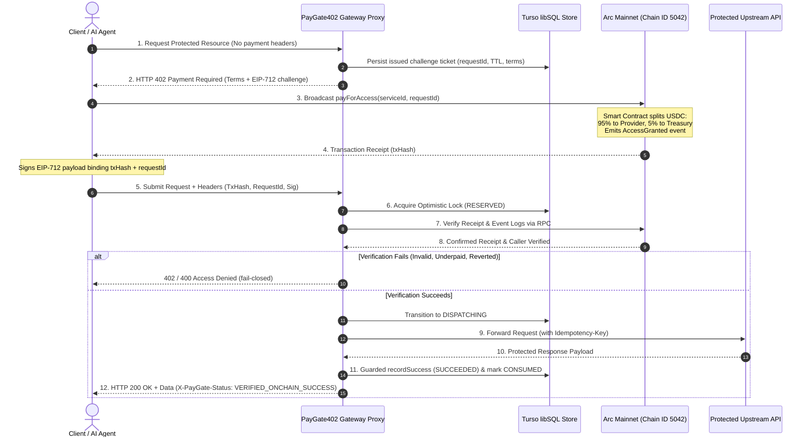
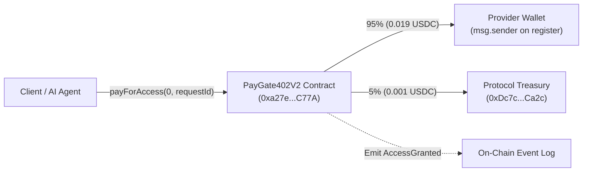
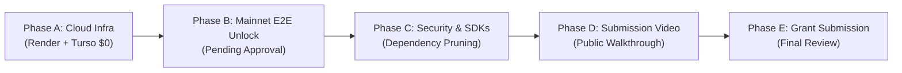

# PayGate402

> HTTP-402 Micropayments for APIs and Autonomous AI Agents, Powered by Arc.

[](contracts/PayGate402V2.sol)
[](tsconfig.json)
[](package.json)
[](https://explorer.arc.io/address/0xa27e390CC82793911D805D4cB3E0c50F2117C77A)
[](https://studio.arc.io/app/32f7ab57-a1ca-4bc8-a29b-86f59668911c)
[](LICENSE)
[](test/gateway.test.ts)

PayGate402 is an on-chain micropayment protocol, reverse proxy gateway daemon, and developer portal built for the [Arc Network](https://arc.io). Inspired by the standard **HTTP 402 Payment Required** status code, PayGate402 enables software services, data providers, and autonomous AI agents to purchase paid API access on a per-call basis using native USDC—with zero subscriptions, zero API key custody, and zero pre-funded credit deposits.

---

## 1. Quick Links & Authoritative References

| Resource | URL / Identifier | Verified Status |
| :--- | :--- | :---: |
| **Production Web Application** | [`https://paygate402-kappa.vercel.app`](https://paygate402-kappa.vercel.app) | **Live on Vercel** |
| **Live Cloud Gateway** | [`https://paygate402.onrender.com`](https://paygate402.onrender.com) | **Live on Render** |
| **Gateway Health Check** | [`https://paygate402.onrender.com/health`](https://paygate402.onrender.com/health) | **HTTP 200 (database: connected)** |
| **Public GitHub Repository** | [`https://github.com/JimmyOgb/PayGate402`](https://github.com/JimmyOgb/PayGate402) | **Public** |
| **Arc Studio Genesis Project** | [`https://studio.arc.io/app/32f7ab57-a1ca-4bc8-a29b-86f59668911c`](https://studio.arc.io/app/32f7ab57-a1ca-4bc8-a29b-86f59668911c) | **Verified Genesis** |
| **Arc Mainnet Smart Contract** | [`0xa27e390CC82793911D805D4cB3E0c50F2117C77A`](https://explorer.arc.io/address/0xa27e390CC82793911D805D4cB3E0c50F2117C77A) | **Deployed on Arc Mainnet** |
| **Contract Creation Tx** | [`0x960e8ebdc10ad125094d8ae1b8635431c458257f714dc8c60496473ae4f1ec20`](https://explorer.arc.io/tx/0x960e8ebdc10ad125094d8ae1b8635431c458257f714dc8c60496473ae4f1ec20) | **Confirmed (0.023953 USDC gas)** |
| **Registered Service ID 0** | [`0xd672237bd13416c215d18a5b03618568ab7ae5cc675b215876c090665bb43e52`](https://explorer.arc.io/tx/0xd672237bd13416c215d18a5b03618568ab7ae5cc675b215876c090665bb43e52) | **Confirmed (Arc Telemetry @ 0.02 USDC)** |
| **Stage 8 Verification Report** | [`STAGE8_PRODUCTION_VERIFICATION_REPORT.md`](STAGE8_PRODUCTION_VERIFICATION_REPORT.md) | **Audit Artifact** |
| **Submission Status Checklist** | [`SUBMISSION_STATUS.md`](SUBMISSION_STATUS.md) | **Audit Artifact** |

---

## 2. Problem Statement & Target Users

### The Problem with Traditional API Monetization
1. **Subscription Friction for Small, Metered Requests:** Traditional APIs require creating accounts, binding credit cards, and committing to $20–$100 monthly minimums. Autonomous AI agents cannot hold credit cards or solve CAPTCHAs.
2. **Operational Burden of Billing & Custody:** API keys are static bearer tokens. If an agent or employee leaks a key, the entire account balance is drained. Managing entitlement databases, rate limit keys, and monthly invoice collection is a major operational drain.
3. **High Fiat Processing Overhead:** Credit card interchange fees (2.9% + $0.30) make true micropayments (e.g. $0.01 to $0.05 per prompt, signal, or inference) economically impossible on fiat payment rails.
4. **Need for Verifiable Payment and Access Decisions:** Decentralized agents and consumers need verifiable, tamper-proof proof that a payment occurred and that access was granted fairly without vendor lock-in.

### The PayGate402 Solution
PayGate402 addresses this by implementing the HTTP 402 Payment Required negotiation protocol directly over Arc Network:
- Service providers register their endpoint and specify a per-call price in native USDC.
- Unauthenticated requests trigger an HTTP 402 challenge ticket rather than a login redirect.
- AI agents or clients pay the exact quoted amount directly to the smart contract on Arc Mainnet.
- The smart contract automatically splits revenue (95% to the provider, 5% to the protocol treasury).
- The gateway verifies the transaction receipt on Arc Mainnet RPC and delivers the protected payload.

### Target Users
- **Autonomous AI Agents:** LLM workflows, LangChain/CrewAI agents, and autonomous data bots that need on-demand data feeds, inference endpoints, and compute without human onboarding.
- **Independent API & Data Providers:** Developers who want to monetize endpoints instantly with zero merchant account setup, zero chargebacks, and instant 95% revenue distribution.
- **AI Tooling & SDK Builders:** Engineers building agent gateways that require deterministic, cryptographically verifiable HTTP 402 negotiation rails.

---

## 3. End-to-End Payment & Access Lifecycle

The gateway implements a trust-minimized, 11-step settlement and delivery flow:

1. **Incoming Request & Route Matching:** Client or autonomous AI agent sends an HTTP request (e.g. `POST /v1/gateway/0/telemetry`) without payment headers. The reverse proxy matches the route prefix `/v1/gateway/:serviceId/*` and parses the payload.
2. **Service Lookup & Pricing Resolution:** The gateway queries the smart contract via RPC (`services(serviceId)`), verifying that the service exists and is active, and retrieves the authoritative price (e.g. `20000` = `0.02 USDC`).
3. **Challenge Creation & EIP-712 Binding:** When payment headers are absent, the gateway generates a cryptographically secure `requestId` (`0x...` 32-byte hex) and computes a Keccak-256 digest of the request body. It binds the service ID, quoted price, path, method, and a 15-minute expiration timestamp (`expiresAt`).
4. **HTTP 402 Payment Required Issuance:** The gateway responds with HTTP 402, returning standard `WWW-Authenticate: PayGate402 ...` headers and an EIP-712 typed challenge payload defining the `PayGateAuthorization` domain.
5. **Persistence of Challenge State:** The challenge record is persisted into the durable store with `status: "ISSUED"`.
6. **Client Settlement on Arc Mainnet:** The client reviews the terms and broadcasts `payForAccess(serviceId, requestId)` on the `PayGate402V2` contract on Arc Mainnet. The contract executes a 95% provider / 5% treasury USDC split and emits an `AccessGranted` event.
7. **Client Submission of Evidence:** The client signs the EIP-712 `PayGateAuthorization` payload using their Web3 wallet private key and retries the request with payment headers:
   - `X-Payment-TxHash`: Arc Mainnet transaction hash.
   - `X-Payment-RequestId`: Bound challenge ticket ID.
   - `X-Payment-Signature`: EIP-712 signature proving ownership of the caller address.
   - `X-Payment-Payer`: Caller address.
8. **Optimistic Lease Lock Acquisition:** The gateway attempts to atomically acquire a lock on `(txHash, requestId)` in the store (`RESERVED` state) with a distributed lease token and expiration timestamp.
9. **On-Chain Receipt & Event Verification:** The gateway queries Arc Mainnet RPC via Viem, validating that the transaction succeeded, confirmed with at least 1 block confirmation, called `payForAccess`, targeted the canonical contract, paid the required USDC amount, emitted `AccessGranted` with matching `serviceId` and `requestId`, and validates the EIP-712 signature against the transaction caller.
10. **Guarded Upstream Dispatch:** Upon verification, the store transitions state from `VERIFYING` to `DISPATCHING`. The gateway dispatches the request to the protected upstream service with an `Idempotency-Key` header.
11. **Guarded Success Commit & Response Delivery:** Once the upstream service responds (200 OK), the gateway atomically transitions the store to `SUCCEEDED` (requiring current state to be `DISPATCHING` with a valid lease token), caches the response, marks the challenge `CONSUMED`, and delivers the payload to the client with `X-PayGate-Status: VERIFIED_ONCHAIN_SUCCESS`.

### Verification Status Across Lifecycle Stages:
- **Stages 1–5 (Challenge Creation & Route Matching):** **VERIFIED** on live deployment and in 100 automated unit tests.
- **Stages 8–9 (Receipt Verification & Fraud Rejection):** **VERIFIED** live on Arc Mainnet RPC (forged tx rejected with `402 TX_NOT_FOUND`).
- **Stages 6, 7, 10, 11 (Genuine Mainnet Settlement & Payload Delivery):** **PENDING** explicit user authorization for a live consumer transaction (currently NOT AUTHORIZED / NOT EXECUTED).



---

## 4. System Architecture

The PayGate402 production architecture spans four verified logical layers:

```mermaid
flowchart TD
    subgraph ClientLayer["1. Consumer & Agent Clients"]
        WebPortal["Web Portal\n(React 18 + Vite on Vercel)"]
        AgentClient["Autonomous AI Agent / CLI Client\n(TypeScript / Python Client)"]
        Web3Signer["Web3 Signer / Wallet\n(Injected EOA / Keystore)"]
    end

    subgraph GatewayLayer["2. PayGate402 Gateway Daemon (Render Cloud)"]
        HttpServer["HTTP Reverse Proxy\n(Node.js Native Server on Port 10000)"]
        RateLimiter["Challenge Rate Limiter\n(Sliding Window IP/Payer Limiter)"]
        StoreAdapter["Durable Store Adapter\n(LibSqlGatewayStore via @libsql/client)"]
        VerifierEngine["Blockchain Verifier\n(Viem RPC Client + EIP-712 Guard)"]
        LeaseManager["Lease Fencing & Crash Recovery\n(Optimistic Locks / UNCERTAIN Fail-Closed)"]
    end

    subgraph StorageLayer["3. Database & Persistence Layer"]
        ProductionDb[("Production Store: Turso Cloud libSQL\n(paygate402-dev on AWS Tokyo)")]
        LocalDb[("Local / Test Store: Embedded node:sqlite\n(WAL Mode Enabled)")]
    end

    subgraph BlockchainLayer["4. Settlement Layer (Arc Mainnet)"]
        ArcRpc["Arc Mainnet RPC\n(https://rpc.mainnet.arc.io)"]
        PayGateContract["PayGate402V2 Contract\n(0xa27e...C77A)"]
        USDCToken["Native USDC Token\n(0x3600...0000)"]
        ProviderWallet["Provider Wallet\n(95% Direct Settlement)"]
        TreasuryWallet["Protocol Treasury\n(5% Fee Account)"]
    end

    subgraph UpstreamLayer["5. Protected Upstream Resources"]
        TelemetryService["Arc L1 Telemetry Service\n(Live Network Metrics)"]
        CustomService["Provider Custom API\n(Inference / Premium Data)"]
    end

    WebPortal -->|Unauthenticated Request| HttpServer
    AgentClient -->|Unauthenticated Request| HttpServer
    HttpServer -->>|HTTP 402 Challenge| ClientLayer
    ClientLayer -->|Sign & Broadcast payForAccess| Web3Signer
    Web3Signer -->|USDC Transfer| PayGateContract
    PayGateContract -->|95% USDC| ProviderWallet
    PayGateContract -->|5% USDC| TreasuryWallet
    PayGateContract -.->|Emit AccessGranted| ArcRpc

    ClientLayer -->|Submit Proof & EIP-712 Sig| HttpServer
    HttpServer -->|Acquire Lock| StoreAdapter
    StoreAdapter <-->|SQL Queries in Prod| ProductionDb
    StoreAdapter -.->|Offline Tests| LocalDb
    HttpServer -->|Verify Tx & Receipt| VerifierEngine
    VerifierEngine <-->|JSON-RPC| ArcRpc

    HttpServer -->|Guarded Dispatch| UpstreamLayer
    UpstreamLayer -->>|Response Payload| HttpServer
    HttpServer -->|Commit Success & Cache| StoreAdapter
    HttpServer -->>|HTTP 200 OK + Payload| ClientLayer
```

---

## 5. Database & Persistence Architecture

A central design requirement of PayGate402 is dual-mode storage: maintaining zero-cost, offline deterministic testability while ensuring durable multi-instance persistence in production.

### Storage Distinction: Production libSQL vs. Local SQLite
- **Production Environment (Render Cloud):** Utilizes `LibSqlGatewayStore` backed by `@libsql/client` connecting over WebSocket/HTTP to **Turso Cloud** (`paygate402-dev` hosted on AWS Tokyo). Turso manages distributed replication and WAL internally. Local file pragmas such as `PRAGMA journal_mode = WAL` are **not** executed against Turso.
- **Local Development & Test Environment:** Utilizes `SqliteGatewayStore` backed by native Node.js `node:sqlite` (`DatabaseSync`). It configures `PRAGMA journal_mode = WAL;` and `PRAGMA busy_timeout = 5000;` for local single-file concurrency and immediate cleanup.
- **Store Factory (`createGatewayStore`):** Evaluates `DATABASE_URL` and `REMOTE_STORE`. If `REMOTE_STORE=true` or a `libsql://` URL is present, it mandates remote storage and throws `GatewayConfigurationError` if the URL is missing, strictly preventing accidental fallback to ephemeral local SQLite.

### Database Schema & Column Definitions

```sql
-- Server-Issued Challenge Tickets
CREATE TABLE IF NOT EXISTS challenges (
  request_id TEXT PRIMARY KEY,
  service_id INTEGER NOT NULL,
  payer TEXT,
  method TEXT NOT NULL,
  path TEXT NOT NULL,
  body_digest TEXT NOT NULL,
  quoted_price INTEGER NOT NULL,
  chain_id INTEGER NOT NULL,
  created_at INTEGER NOT NULL,
  expires_at INTEGER NOT NULL,
  status TEXT NOT NULL DEFAULT 'ISSUED'
);

CREATE INDEX IF NOT EXISTS idx_challenges_payer ON challenges(payer);

-- Replay-Protected Payment Records & Lease Fencing
CREATE TABLE IF NOT EXISTS payments (
  tx_hash TEXT PRIMARY KEY,
  request_id TEXT NOT NULL,
  service_id INTEGER NOT NULL,
  caller TEXT NOT NULL,
  amount_paid INTEGER NOT NULL,
  state TEXT NOT NULL DEFAULT 'RESERVED',
  cached_response TEXT,
  failure_reason TEXT,
  created_at INTEGER NOT NULL,
  updated_at INTEGER NOT NULL,
  consumed_at INTEGER,
  lease_owner TEXT,
  lease_expires_at INTEGER,
  lease_token TEXT
);

CREATE INDEX IF NOT EXISTS idx_payments_request ON payments(request_id);
CREATE INDEX IF NOT EXISTS idx_payments_lease_expiry ON payments(lease_expires_at);
```

### Payment State Machine & Concurrency Safeguards
The lifecycle of a payment record follows strict state transitions:

```
[Incoming Tx] ──► RESERVED (Lease Acquired)
                     │
                     ▼
                 VERIFYING (RPC Receipt Check)
                     │
                     ├────────► FAILED (Pre-dispatch failure; safe for retry)
                     ▼
                DISPATCHING (Upstream Forwarding)
                     │
                     ├────────► SUCCEEDED (Guarded commit; payload cached; challenge CONSUMED)
                     │
                     └────────► UNCERTAIN (Upstream timeout; permanently locked fail-closed)
```

1. **Atomic Lock Acquisition (`tryAcquirePaymentLock`):** When a client submits payment evidence, the gateway executes an atomic transaction. If `tx_hash` already exists in `SUCCEEDED` state, it returns the cached response. If in-flight, it returns `CONCURRENT_CONFLICT`.
2. **Distributed Lease Fencing:** Each in-flight reservation generates a cryptographically random `lease_token` with an expiration timestamp (`lease_expires_at`, default 30s). Only the worker holding the active token can mutate state.
3. **Fail-Closed Upstream Timeout (`UNCERTAIN`):** If upstream dispatch commences but times out or the container crashes, the state transitions permanently to `UNCERTAIN`. To prevent duplicate billing or side-effects, the payment cannot be retried.
4. **Crash Recovery (`recoverStartupStates`):** On gateway startup, lingering pre-dispatch reservations (`RESERVED`/`VERIFYING`) reset to `FAILED` for retry, while interrupted dispatches (`DISPATCHING`) lock to `UNCERTAIN`.
5. **Lost-Commit Idempotency Reconciliation:** If network dropouts occur during transaction `COMMIT` to Turso, the store immediately queries the database. If the record committed remotely with matching lease tokens, the lock is recovered cleanly without throwing duplicate primary key errors.
6. **Active Database Ping & Fail-Closed Availability:** The gateway queries `SELECT 1 as alive;` via `db.ping()`. If the remote database is unreachable, `GET /health` immediately returns HTTP `503 Service Unavailable` (`status: "unhealthy", database: "unreachable"`), ensuring external balancers do not route traffic to a disconnected instance.

---

## 6. Gateway Internals & Security Boundaries

PayGate402 enforces strict security invariants across off-chain and on-chain execution:

1. **Private Key Confidentiality:** The gateway **never** handles, transmits, or stores user or provider private keys. All transactions are signed exclusively through user-controlled Web3 wallets (e.g. MetaMask) or client-side agent keystores.
2. **Mempool Front-Running Immunity (EIP-712):** An on-chain transaction receipt alone does **not** grant access to protected resources. The gateway requires an **EIP-712 cryptographic signature** over the payment authorization payload:
   ```
   keccak256(PayGateAuthorization(serviceId, requestId, txHash, method, path, bodyDigest, quotedPrice, expiresAt))
   ```
   The gateway verifies that `recoverAddress(signature) == receipt.caller`. An attacker monitoring the mempool cannot reuse a legitimate user's transaction hash.
3. **Sliding-Window Rate Limiting:** A sliding-window challenge rate limiter (`ChallengeRateLimiter`) restricts excessive challenge ticket generation per IP/payer address (default 60 challenges per minute), mitigating resource exhaustion.
4. **Production Mock Isolation:** Route `/v1/mock/register-payment` returns HTTP 404 in production mode (`mockRpc: false`). When testing in mock mode, it mandates authentication via `X-Gateway-Test-Secret` and marks all delivered headers with `X-PayGate-Simulation: true`.

---

## 7. Smart Contract Architecture & Economic Settlement Model

The smart contract layer is implemented in [`contracts/PayGate402V2.sol`](contracts/PayGate402V2.sol), compiled with Solidity 0.8.28 (Paris EVM target, 200 optimizer runs).



### Architectural Contract Invariants:
1. **Checks-Effects-Interactions (CEI) & ReentrancyGuard:** State mutations (`usedRequestIds[requestId] = true`, revenue accounting) occur strictly before external ERC-20 `transferFrom` calls, reinforced with OpenZeppelin's `nonReentrant` modifier.
2. **Single-Level Request ID Mapping:** Replay protection is enforced via `mapping(bytes32 => bool) public usedRequestIds`, preventing ticket reuse across any service or caller.
3. **Immutable 95/5 Revenue Split:**
   ```solidity
   uint256 public constant PROTOCOL_FEE_BPS = 500;   // 5.00%
   uint256 public constant BPS_DENOMINATOR = 10000;

   uint256 fee = (service.priceInUsdc * PROTOCOL_FEE_BPS) / BPS_DENOMINATOR;
   uint256 providerAmount = service.priceInUsdc - fee;
   ```
   For the configured Service 0 price of **0.02 USDC** (20,000 atomic units):
   - **Provider Allocation:** `0.019000 USDC` (19,000 units)
   - **Protocol Treasury Allocation:** `0.001000 USDC` (1,000 units)
   *(Note: This allocation is an illustrative calculation based on the contract formula and Service 0's quoted price; it is awaiting observation of an executed live consumer call on the gateway.)*

---

## 8. API Interface & Verified Route Catalog

| Endpoint | Method | Status | Description |
| :--- | :---: | :---: | :--- |
| `/health` | `GET` | **200 OK** | System health, live block height, chain ID, and active Turso connection ping (`database: "connected"`). |
| `/v1/telemetry/arc-mainnet` | `GET` | **200 OK** | Direct un-gated proxy to `https://rpc.mainnet.arc.io` reporting live block height, gas utilization, and base fees. |
| `/v1/gateway/:serviceId/*` | `ANY` | **402 / 200** | Protected reverse proxy route. Returns HTTP 402 challenge ticket if unpaid; delivers upstream payload with `X-PayGate-Status` if verified. |
| `/v1/gateway/verify-payment` | `POST` | **200 / 400** | Standalone cryptographic verification endpoint validating on-chain receipts and EIP-712 signatures. |
| `/v1/mock/register-payment` | `POST` | **404 / 200** | Isolated testing fixture endpoint. Strictly returns `404 Not Found` in live production mode. |
| `/` | `GET` | **404 Not Found** | Unmapped root path. Returns `{"error": "Route / not found", "code": "NOT_FOUND"}` by design. |

### Example: HTTP 402 Challenge Negotiation
```http
POST /v1/gateway/0/telemetry HTTP/1.1
Host: paygate402.onrender.com
Content-Type: application/json

{}
```

**Response (HTTP 402 Payment Required):**
```http
HTTP/1.1 402 Payment Required
Content-Type: application/json
www-authenticate: PayGate402 serviceId=0, chainId=5042, requestId=0xbcc84c236462e42ef42e5d94a921b27c41492a45300a1d5b531f68513ecbcd78
x-payment-contract: 0xa27e390CC82793911D805D4cB3E0c50F2117C77A
x-payment-token: 0x3600000000000000000000000000000000000000
x-required-amount: 20000
x-payment-requestid: 0xbcc84c236462e42ef42e5d94a921b27c41492a45300a1d5b531f68513ecbcd78
x-payment-expires: 1792762581262

{
  "error": "HTTP 402 Payment Required",
  "message": "On-chain payment required. Invoke payForAccess(serviceId, requestId) on Arc Mainnet.",
  "challenge": {
    "serviceId": "0",
    "requestId": "0xbcc84c236462e42ef42e5d94a921b27c41492a45300a1d5b531f68513ecbcd78",
    "quotedPrice": "20000",
    "quotedPriceFormatted": "0.020000 USDC",
    "chainId": 5042,
    "contract": "0xa27e390CC82793911D805D4cB3E0c50F2117C77A",
    "usdcToken": "0x3600000000000000000000000000000000000000",
    "method": "POST",
    "path": "/telemetry",
    "bodyDigest": "0xb48d38f93eaa084033fc5970bf96e559c33c4cdc07d889ab00b4d63f9590739d",
    "expiresAt": 1792762581262,
    "eip712Domain": {
      "name": "PayGate402 Gateway",
      "version": "1",
      "chainId": 5042,
      "verifyingContract": "0xa27e390CC82793911D805D4cB3E0c50F2117C77A"
    }
  }
}
```

---

## 9. Production Deployment & Live Verification

PayGate402 is deployed across production cloud environments on a strict $0-first budget:

- **Gateway Daemon Hosting:** Render Free Web Service (`paygate402`) in Oregon (aws-us-west-2).
- **Persistent Database:** Turso Cloud Starter (`paygate402-dev`) on AWS Tokyo.
- **Web Application Portal:** Vercel Global Edge Network (`paygate402-kappa.vercel.app`).
- **Live Commit:** [`613aba57d9b32fa19395d74d3e881acd702e636a`](https://github.com/JimmyOgb/PayGate402/commit/613aba57d9b32fa19395d74d3e881acd702e636a).
- **Zero-Forge Clean Container Startup:** The startup script `scripts/ensure_artifacts.js` restores missing contract artifacts from git-tracked metadata before the gateway launches, eliminating solc/Foundry binary requirements on Render.

---

## 10. Testing Methodology & Current Verification Evidence

PayGate402 is backed by **126 automated tests** executing locally without external testnet dependencies:

| Suite Name | File | Tests | Status | Scope |
| :--- | :--- | :---: | :---: | :--- |
| **Gateway Security & Payments** | [`test/gateway.test.ts`](test/gateway.test.ts) | **100** | **PASS** | HTTP 402 challenge lifecycle, receipt verification, EIP-712 signer validation, atomic SQLite/libSQL locks, lease renewals, crash recovery, simulation header partitioning, `SQLITE_BUSY` contention, lost-commit reconciliation, zero-forge ABI fallback. |
| **Homepage UX Verification** | [`test/homepage_ux.test.ts`](test/homepage_ux.test.ts) | **8** | **PASS** | Meridian full-viewport hero layout, persistent navigation header, 1280×800 viewport CSS boundaries, Arc Mainnet strict runtime rules. |
| **Pipeline & Artifact Validation** | [`test/pipeline_v2_validation.test.ts`](test/pipeline_v2_validation.test.ts) | **11** | **PASS** | Solc 0.8.28 output, Paris EVM compatibility, SHA-256 bytecode fingerprint, constructor ABI encoding, zero library placeholders. |
| **Mainnet Deployment Preflight** | [`test/deploy_v2_mainnet.test.ts`](test/deploy_v2_mainnet.test.ts) | **7** | **PASS** | Standalone deployment dry-run, live Mainnet preflight check, buffered gas calculation (1.5M limit), fail-closed rejection of testnet RPCs. |
| **Typecheck** | `npm run typecheck` (`tsc --noEmit`) | N/A | **0 ERRORS** | TypeScript static type verification across all source files, scripts, and tests. |
| **Production Build** | `npm run build` (`tsc && vite build`) | N/A | **SUCCESS** | Production bundle generated in 49.8s. |

### Dependency Security Review (`npm audit` & Render Discrepancy Resolution)
Running `npm audit` on October 23, 2026 reports **73 advisories** (0 Critical, 20 High, 40 Moderate, 13 Low), whereas earlier Render deployment logs reported **59 advisories (15 High)**.

#### Discrepancy Resolution:
1. **Production vs Full Scope:** The Render build environment executed `npm install --legacy-peer-deps` in a production container prior to the introduction of `@libsql/client`, reporting 59 advisories (15 high) across production-only dependencies.
2. **Current Production Dependencies (`npm audit --omit=dev`):** Running `npm audit --omit=dev --json` reveals **61 advisories (15 High, 38 Moderate, 8 Low)**. The addition of `@libsql/client` introduced 2 sub-dependency advisories.
3. **Full Project Scope (`npm audit`):** The full scan includes development dependencies, reporting **73 advisories (20 High, 40 Moderate, 13 Low)**. The 12 additional findings (5 high, 2 moderate, 5 low) reside in build-time tooling (e.g. `vite-plugin-node-polyfills`).

#### Threat Assessment & Risk Analysis:
- **Transitive Scope:** All 15 production high-severity advisories originate from `@circle-fin/app-kit` transitively pulling `@coral-xyz/anchor` and `@solana/web3.js` from the original Arc Studio project template.
- **Concrete Risk Vectors:**
  - `undici` (GHSA-rfgv-xxqx-mfg5): Denial of Service via WebSocket subprotocols and HTTP response splitting. Exposure is confined to `@firebase` calls within Circle user-controlled wallet flows (unused by PayGate402).
  - `uuid` (GHSA-w5hq-g745-h8pq): Missing buffer bounds check in v3/v5/v6. Could impact memory safety if exposed to untrusted external buffers in Web3 SDKs.
- **Production Gateway Isolation:** The standalone reverse proxy daemon (`src/gateway/*`) does **NOT** import or execute any Circle or Solana packages; it runs in pure EVM/Arc mode with Viem and `@libsql/client`. However, because these packages reside in the web application build tree, they cannot be dismissed as harmless.
- **Remediation Strategy:** Running `npm audit fix --force` would downgrade packages and break Wagmi v2 / ConnectKit / React 18 frontend compilation. A targeted dependency pruning is scheduled under Roadmap Phase C to remove unused inherited packages safely without breaking changes.

---

## 11. Explicit Limitations & Current Status

To maintain strict technical transparency, PayGate402 categorizes all project items into verified completions versus pending milestones:

### Reported as Complete
- Arc Studio project conceived, scaffolded, and linked.
- Public GitHub repository active and up to date.
- Live Render gateway deployed and responsive on port 10000.
- Health endpoint returning HTTP 200 with confirmed Turso libSQL connectivity.
- HTTP 402 challenge issuance, EIP-712 binding, and on-chain invalid-tx rejection tested live.
- 126 automated tests, TypeScript typecheck, and Vite production build passing cleanly.

### Still Pending
- **Genuine Consumer Payment Through Gateway:** A real consumer payment initiated through the deployed gateway proxy.
- **Independent Verification of Distribution:** Verifying actual 95% provider and 5% treasury split from on-chain event logs of a live cloud gateway purchase.
- **End-to-End Delivery Proof:** Independent proof that successful payment verification unlocks the intended protected upstream data payload.
- **Public Walkthrough Video:** Production and publication of a video walkthrough meeting Arc Microgrants criteria.
- **Final Eligibility Review & Attestations:** Final review of application fields, links, and submission approval.

> **Historical Note on Prior Transaction `0xa7ba388e...`:**
> The transaction reported in earlier development was an on-chain self-payment (deployer wallet paying deployer service during smart contract unit testing). It was executed directly against the smart contract before the cloud gateway challenge flow was deployed, and was never issued or redeemed through the live gateway. **It does not satisfy the requirement for genuine gateway consumer-payment proof.**

---

## 12. Measurable Product Roadmap



### Phase A — Production Infrastructure & Protocol Verification
- **Status:** **Reported Complete (Verified in Stage 8)**.
- **Tasks Completed:**
  - Deployed gateway daemon on Render Free Web Service.
  - Implemented `scripts/ensure_artifacts.js` for zero-Foundry clean startup.
  - Connected remote Turso libSQL database (`paygate402-dev`) on AWS Tokyo.
  - Verified `GET /health` returns HTTP 200 and `database: "connected"`.
  - Verified HTTP 402 challenge flow, EIP-712 binding, and on-chain invalid-tx rejection.
  - Disabled mock fixture registration endpoints in live production mode.
  - Ran 126 automated tests, typecheck, and production build.
- **Acceptance Criteria Met:** Production gateway is live, database connectivity confirmed, all tests pass, and evidence is preserved in [`STAGE8_PRODUCTION_VERIFICATION_REPORT.md`](STAGE8_PRODUCTION_VERIFICATION_REPORT.md).

### Phase B — Genuine Consumer Payment Through the Live Gateway
- **Status:** **BLOCKED ON EXPLICIT USER APPROVAL & END-TO-END PROOF (NOT AUTHORIZED / NOT EXECUTED)**.
- **Objective:** Execute and record a complete, independent Arc Mainnet payment flow from initial HTTP 402 challenge to successful protected response delivery.
- **Proposed Transaction Parameters:**
  - **Resource Route:** `https://paygate402.onrender.com/v1/gateway/0/telemetry`
  - **Payment Amount:** `0.02 USDC` (20,000 atomic units)
  - **Estimated Gas:** ~`0.0006 USDC` (subject to wallet/RPC confirmation)
  - **Proposed Provider Allocation (95%):** `0.019 USDC`
  - **Proposed Treasury Allocation (5%):** `0.001 USDC`
  - **Network:** Arc Mainnet (Chain ID `5042`)
- **Execution Protocol:**
  1. Inspect exact payment terms from live HTTP 402 challenge ticket.
  2. Verify contract address, token address, chain ID, recipient, and allowance.
  3. Confirm transaction matches payment protocol and spend is within stated limit.
  4. Present exact transaction details for user sign-off.
  5. Await explicit approval before signing or broadcasting anything.
  6. Capture confirmed transaction hash on ArcScan.
  7. Verify receipt, `AccessGranted` event logs, and provider/treasury distribution.
  8. Submit evidence to gateway, verifying HTTP 200 payload delivery with `X-PayGate-Status: VERIFIED_ONCHAIN_SUCCESS`.
  9. Document results honestly in [`SUBMISSION_STATUS.md`](SUBMISSION_STATUS.md).
- **Acceptance Criteria:** A public ArcScan transaction link and matching gateway logs proving non-builder USDC settlement and payload release.

### Phase C — Security, Reliability & Dependency Review
- **Status:** **Partially Verified; Further Review Required**.
- **Tasks:**
  - Audit the dependency vulnerabilities (73 total in full repo, 61 in production scope, reconciling the 59 reported in earlier pre-libsql Render logs).
  - Prune unused `@circle-fin/*`, `@coral-xyz/anchor`, and `@solana/web3.js` dependencies from the frontend bundle to remediate transitive CVE exposure (`undici`, `uuid`).
  - Add regression tests covering lease expiration edge cases.
  - Assess production gateway exposure to upstream socket dropouts.
  - Review environment variable validation and secret handling.
  - Improve structured logging while maintaining strict confidentiality of headers.
- **Acceptance Criteria:** Unused dependencies pruned, zero regression in automated test suites, and audit findings documented with severity and remediation notes.

### Phase D — Submission Evidence & Public Walkthrough
- **Status:** **Pending**.
- **Tasks:**
  - Record a 1080p walkthrough video following [`docs/ARC_MICROGRANTS_WALKTHROUGH.md`](docs/ARC_MICROGRANTS_WALKTHROUGH.md).
  - Demonstrate Arc Studio project provenance, live application portal, and live gateway health.
  - Demonstrate HTTP 402 challenge creation and on-chain fake transaction rejection.
  - Demonstrate genuine verified payment and resulting access only after Phase B passes.
  - Publish walkthrough video to an approved public platform (YouTube/Loom).
  - Confirm video and all repository links are publicly accessible.
- **Acceptance Criteria:** Video is public, contains no secrets, demonstrates real functionality without simulation labels, and matches repository evidence.

### Phase E — Final Eligibility Review & Application Submission
- **Status:** **Pending**.
- **Tasks:**
  - Verify official program rules, eligibility criteria, and deadline (November 1, 2026).
  - Review Arc Studio project URL, live app URL, and public GitHub access.
  - Verify explorer-linked Mainnet contract and payment transactions.
  - Review project description in [`docs/ARC_MICROGRANTS_SUBMISSION_DESCRIPTION.md`](docs/ARC_MICROGRANTS_SUBMISSION_DESCRIPTION.md).
  - Verify public builder profile and originality attestations.
  - Obtain final user approval before submitting the application.
- **Acceptance Criteria:** All mandatory fields have valid evidence, all claims are substantiated, and explicit user approval is granted.

---

## 13. Transaction Evidence Table

| Evidence Item | Target / Identifier | Current Status | Verification Source |
| :--- | :--- | :---: | :--- |
| **Gateway Deployment** | `https://paygate402.onrender.com` | **Reported Live** | Render deployment of commit `613aba5` |
| **Gateway Health** | `https://paygate402.onrender.com/health` | **Reported HTTP 200** | Live curl check (`status: healthy`) |
| **Remote Database** | Turso libSQL (`paygate402-dev`) | **Reported Connected** | Live curl check (`database: connected`) |
| **HTTP 402 Challenge** | `/v1/gateway/0/telemetry` | **Reported Tested** | Live HTTP 402 response with EIP-712 challenge |
| **Forged Tx Rejection** | `0x0000...dead` | **Reported Tested** | Live HTTP 402 response (`TX_NOT_FOUND`) |
| **Prior Builder Self-Payment** | `0xa7ba388e...` | **Historical Only** | Confirmed on ArcScan; not valid as consumer proof |
| **Proposed 0.02 USDC Payment** | `/v1/gateway/0/telemetry` | **NOT AUTHORIZED / NOT EXECUTED** | Proposed 0.02 USDC payment awaiting explicit user sign-off |
| **Genuine Gateway Tx Hash** | Mainnet Transaction | **Pending** | Scheduled under Roadmap Phase B |
| **Verified Revenue Split** | 95% Provider / 5% Treasury | **Pending** | Scheduled under Roadmap Phase B |
| **Protected Access Release** | Payload Delivery (HTTP 200) | **Pending** | Scheduled under Roadmap Phase B |
| **Public Walkthrough Video** | Video URL | **Pending** | Scripted in `docs/ARC_MICROGRANTS_WALKTHROUGH.md` |
| **Final Application Submission** | Arc Microgrants Portal | **Not Yet Ready** | Requires Phase B and Phase D completion |

---

## 14. Arc Studio Development Story & Provenance

PayGate402 originated within **Arc Studio** and was subsequently hardened through local engineering:

### What Was Created in Arc Studio
- **Genesis Pull (2026-10-15):** The original repository scaffold, Wagmi configuration, Arc Dark theme, ConnectKit Web3 wallet connection, and initial V1 contract (`contracts/PayGate402.sol`) were authored inside Arc Studio project [`32f7ab57-a1ca-4bc8-a29b-86f59668911c`](https://studio.arc.io/app/32f7ab57-a1ca-4bc8-a29b-86f59668911c).
- **Core Product Mechanics:** The HTTP 402 challenge concept, exact-amount USDC allowances, and the 95/5 revenue split design were conceived and scaffolded in Studio.

### What Was Hardened Locally
- **`PayGate402V2.sol` Hardening:** The deployed Arc Mainnet contract added OpenZeppelin `ReentrancyGuard`, optimized single-level `usedRequestIds` mapping, and removed legacy unused functions. Compiled with solc 0.8.28 (Paris EVM, 200 runs).
- **Zero-Forge Clean Startup:** Developed `scripts/ensure_artifacts.js` allowing cloud containers without Foundry toolchains to resolve contract ABIs cleanly.
- **HTTP 402 Gateway Proxy Engine:** Built from scratch in `src/gateway/` with zero heavy frameworks, implementing atomic state locking, challenge rate limiting, and Viem RPC verification.
- **Lease-Fenced Concurrency & libSQL Storage:** Implemented distributed multi-instance safety with fencing tokens and the `LibSqlGatewayStore` adapter for Turso Cloud persistence.
- **Meridian UI Design System:** Expanded the frontend with full-viewport responsive hero mechanics and developer integration tools.

---

## 15. Local Setup & Testing

### Prerequisites
- **Node.js:** `v22.6.0+` or `v24 LTS`
- **Package Manager:** `npm` (with `--legacy-peer-deps`)

### Quickstart Setup
```bash
# 1. Clone repository
git clone https://github.com/JimmyOgb/PayGate402.git
cd PayGate402

# 2. Install dependencies
npm ci --legacy-peer-deps

# 3. Verify static types
npm run typecheck

# 4. Run automated test suites (126 tests across 4 suites)
npm run test:gateway
node test/homepage_ux.test.ts
node test/pipeline_v2_validation.test.ts
node test/deploy_v2_mainnet.test.ts

# 5. Start local frontend development server
npm run dev
# Accessible at http://localhost:5173

# 6. Start local gateway daemon
npm run gateway:start
# Running at http://localhost:4020
```

### Gateway Configuration Reference

| Environment Variable | Required | Default | Scope & Purpose |
| :--- | :---: | :---: | :--- |
| `CHAIN_ID` | Yes | `5042` | Arc Mainnet (`5042`) or Arc Testnet (`5042002`). |
| `PAYGATE_CONTRACT_ADDRESS` | Yes | `0xa27e...C77A` | Deployed `PayGate402V2` contract address on Arc Mainnet. |
| `USDC_TOKEN_ADDRESS` | Optional | `0x3600...0000` | Canonical native USDC token address on Arc Mainnet. |
| `ARC_RPC_URL` / `RPC_URL` | Optional | `https://rpc.mainnet.arc.io` | Arc Mainnet JSON-RPC endpoint. |
| `PORT` | Optional | `4020` (Local) / `10000` (Render) | HTTP port for the reverse proxy daemon. |
| `DATABASE_URL` | Optional | `gateway.db` | libSQL URL (`libsql://...` in prod) or SQLite file path (`:memory:` in local tests). |
| `TURSO_AUTH_TOKEN` | Optional | None | Bearer token for remote Turso Cloud database. |
| `REMOTE_STORE` | Optional | `false` | When `true`, enforces fail-closed remote libSQL storage. |
| `GATEWAY_TEST_SECRET` | Optional | None | Required bearer secret to register mock fixtures when running tests. |
| `MOCK_RPC` | Optional | `false` | When `true`, enables isolated mock client for offline tests. |

---

## 16. License & Builder Profile

### Smart Contract & Source License
PayGate402 is open-source software licensed under the [MIT License](LICENSE).

### Builder Contact & Repository
- **GitHub Profile:** [@JimmyOgb](https://github.com/JimmyOgb)
- **Repository:** [https://github.com/JimmyOgb/PayGate402](https://github.com/JimmyOgb/PayGate402)
- **Ecosystem:** [Arc Network](https://arc.io) | [Arc Studio](https://studio.arc.io)
