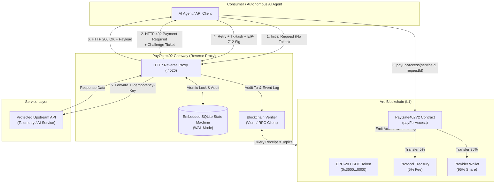
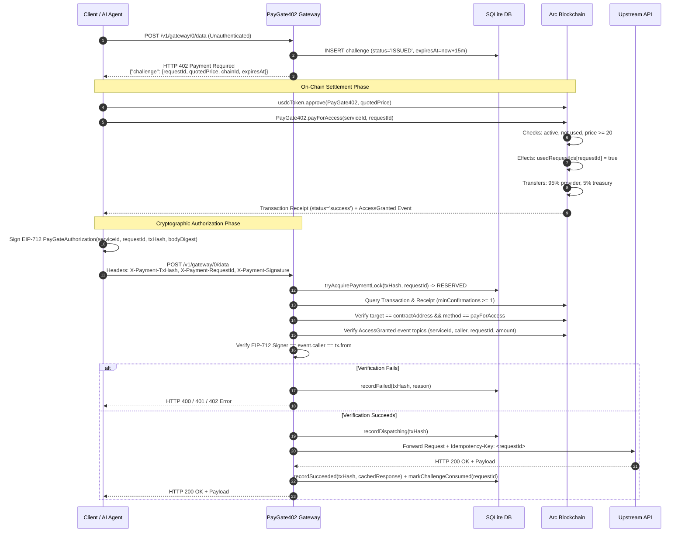

# PayGate402

> HTTP 402 Pay-Per-Call Micropayment Protocol & AI Agent Gateway on Arc

[](contracts/)
[](test/)
[](tsconfig.json)
[](https://explorer.arc.io/address/0xa27e390CC82793911D805D4cB3E0c50F2117C77A)
[](https://explorer.testnet.arc.io/address/0xcc69506b784dffda4ee4d221b122303304099971)

PayGate402 is an on-chain protocol, reverse proxy gateway, and developer portal implementing the standard **HTTP 402 Payment Required** workflow for machine-to-machine APIs and autonomous AI agents on the [Arc Network](https://arc.io).

Consumers and AI agents settle micro-fees in USDC per call without subscriptions, API key custody, or pre-funded SaaS accounts. The smart contract automatically splits revenue (95% to the service provider and 5% to the protocol treasury). Access is verified per-call using on-chain settlement receipts combined with EIP-712 cryptographic caller authorization.

---

## Table of Contents

- [Project Status & Transparency](#project-status--transparency)
- [Key Features](#key-features)
- [System Architecture](#system-architecture)
- [HTTP 402 Handshake & Payment Lifecycle](#http-402-handshake--payment-lifecycle)
- [Smart Contract Specifications](#smart-contract-specifications)
  - [Contract v1 vs. Contract v2](#contract-v1-vs-contract-v2)
  - [Revenue Split & Rounding Arithmetic](#revenue-split--rounding-arithmetic)
- [Gateway Proxy & API Reference](#gateway-proxy--api-reference)
  - [Endpoints](#endpoints)
  - [Request & Response Headers](#request--response-headers)
  - [Error Code Taxonomy](#error-code-taxonomy)
- [Service Catalog & Upstream Adapters](#service-catalog--upstream-adapters)
  - [Live Upstream: Arc L1 Real-Time Telemetry](#live-upstream-arc-l1-real-time-telemetry)
  - [Reference Demo Templates](#reference-demo-templates)
- [Network & Token Configuration](#network--token-configuration)
  - [Dual-Token Gas & Payment Accounting](#dual-token-gas--payment-accounting)
- [Quickstart & Local Setup](#quickstart--local-setup)
  - [Prerequisites](#prerequisites)
  - [Installation](#installation)
  - [Running the Gateway](#running-the-gateway)
  - [Running the Frontend Portal](#running-the-frontend-portal)
- [Security Model & Operational Considerations](#security-model--operational-considerations)
- [Verification & Test Evidence](#verification--test-evidence)
- [Deployment Status & Future Checklist](#deployment-status--future-checklist)
- [Roadmap](#roadmap)
- [Contributing & License](#contributing--license)
- [Links & References](#links--references)

---

## Project Status & Transparency

PayGate402 is under active engineering development. The technical status of the codebase is documented below:

- **Local Verification Status:** **All 99 automated tests pass** (19 genuine EVM bytecode tests, 62 gateway security and integration tests, 11 artifact pipeline validation tests, 7 deployment safety tests). TypeScript typecheck, oxlint, and production build pass with zero warnings or errors.
- **Arc Mainnet (Chain ID `5042`):** PayGate402V2 is deployed at [`0xa27e390CC82793911D805D4cB3E0c50F2117C77A`](https://explorer.arc.io/address/0xa27e390CC82793911D805D4cB3E0c50F2117C77A) (Deployment Tx: [`0x960e8ebdc10ad125094d8ae1b8635431c458257f714dc8c60496473ae4f1ec20`](https://explorer.arc.io/tx/0x960e8ebdc10ad125094d8ae1b8635431c458257f714dc8c60496473ae4f1ec20)). Deployed with official USDC (`0x3600000000000000000000000000000000000000`) and immutable protocol treasury (`0xDc7c4aFBa201D2a3108061107346e9ff70f0Ca2c`).
- **Arc Testnet (Chain ID `5042002`):** Historical Contract v1 is deployed at [`0xcc69506b784dffda4ee4d221b122303304099971`](https://explorer.testnet.arc.io/address/0xcc69506b784dffda4ee4d221b122303304099971).
- **Live Payment Testing Status:** Live end-to-end payment testing with real Mainnet USDC micropayments has **not yet been executed** (pending separate owner authorization). All verifications have been conducted using in-process EVM tests, testnet faucet transactions, and read-only Mainnet RPC checks.
- **Service Catalog Integrity:** Only the **Arc L1 Real-Time Telemetry** service connects to an authentic upstream network (`https://rpc.mainnet.arc.io`). All other catalog items are explicitly labeled `[DEMO — SYNTHETIC DATA]` and provide simulated responses for integration testing.
- **Audit Status:** No third-party commercial security audit has been performed. Built with Arc Studio.

> [!IMPORTANT]
> The historical Testnet v1 deployment (`PayGate402.sol`) differs materially from the hardened v2 architecture (`PayGate402V2.sol`). Do not assume Testnet v1 contract behavior represents v2 Mainnet semantics.

---

## Key Features

- **Standard HTTP 402 Handshake:** Intercepts unauthenticated requests and returns a structured 402 challenge ticket with price quotes, expiration, and cryptographic salt.
- **Autonomous Settlement:** AI agents and clients pay via standard ERC-20 `transferFrom` calls directly on the Arc blockchain.
- **Automated 95/5 Revenue Split:** Contract distributes 95% of the call fee to the provider and 5% to the protocol treasury in a single transaction with zero division loss.
- **Contract-Wide Replay Protection:** Request IDs are 32-byte cryptographic hashes (`bytes32`) enforced strictly single-use across all callers, services, and transactions.
- **EIP-712 Cryptographic Caller Binding:** Callers sign an EIP-712 authorization payload binding the challenge, transaction hash, and request body. This prevents front-running and mempool transaction hijacking.
- **Defense-in-Depth Reentrancy Protection:** Inherits OpenZeppelin's `ReentrancyGuard` (`nonReentrant`) and strictly adheres to the Checks-Effects-Interactions (CEI) pattern.
- **ACID Database State Machine:** Gateway utilizes an embedded, WAL-enabled SQLite database with row-level reservation locks (`PENDING` $\rightarrow$ `VERIFYING` $\rightarrow$ `RESERVED` $\rightarrow$ `DISPATCHING` $\rightarrow$ `SUCCEEDED`).
- **Fail-Closed Upstream Protection:** Injects an `Idempotency-Key` header into upstream dispatches and traps network timeouts into an `UNCERTAIN` state to protect against double execution.
- **Dual-Token Accounting:** Distinguishes between native Arc USDC (18 decimals for gas) and ERC-20 USDC (6 decimals for payment transfers).

---

## System Architecture



---

## HTTP 402 Handshake & Payment Lifecycle



---

## Smart Contract Specifications

### Contract v1 vs. Contract v2

The repository includes both the historical v1 deployment and the hardened v2 architecture:

| Property | Contract v1 (`PayGate402.sol`) | Contract v2 (`PayGate402V2.sol`) |
| :--- | :--- | :--- |
| **Status** | Deployed on Arc Testnet | **Undeployed** (Target: Arc Mainnet) |
| **Address** | `0xcc69506b784dffda4ee4d221b122303304099971` | `null` (Unconfigured) |
| **Chain ID** | `5042002` (Arc Testnet) | `5042` (Arc Mainnet) |
| **Access Model** | Permanent on-chain `hasAccess` flag (flawed) | **Pure per-call** access via event receipts |
| **`verifyAccess()` Method** | Present (`hasAccess[id][caller]`) | **Removed** (prevents infinite access exploit) |
| **Request ID Mapping** | Scoped: `[serviceId][caller][requestId]` | **Contract-Wide:** `mapping(bytes32 => bool)` |
| **Reentrancy Guard** | None | **OpenZeppelin `ReentrancyGuard` (`nonReentrant`)** |
| **Checks-Effects-Interactions** | State updated after transfers | **Strict CEI:** `usedRequestIds` set before transfers |
| **Service Name Validation** | No length check | `require(bytes(name).length > 0)` |
| **Minimum Call Price** | 20 base units ($0.000020 USDC) | 20 base units ($0.000020 USDC) |
| **Fee Split** | 95% Provider / 5% Treasury | 95% Provider / 5% Treasury |
| **Optimized Bytecode Size** | 7,782 bytes | **4,393 bytes** (via `--optimize --optimize-runs 200`) |

> [!CAUTION]
> **V1 Historical Security Warning:** In `PayGate402.sol` v1, calling `payForAccess` permanently sets `hasAccess[serviceId][caller] = true`. Relying solely on `verifyAccess()` allows a wallet to pay once and receive free requests indefinitely. In production, backends must verify individual `AccessGranted` event receipts and single-use `requestId` challenges via the gateway.

### Revenue Split & Rounding Arithmetic

Contract fees are calculated using basis points (`BPS_DENOMINATOR = 10000`, `PROTOCOL_FEE_BPS = 500`):

$$\text{protocolFee} = \left\lfloor \frac{\text{priceInUsdc} \times 500}{10000} \right\rfloor$$

$$\text{providerAmount} = \text{priceInUsdc} - \text{protocolFee}$$

- **Zero Residue Property:** Because `providerAmount` is computed by subtraction, the invariant $\text{protocolFee} + \text{providerAmount} \equiv \text{priceInUsdc}$ holds for all integers. Zero base units are trapped or lost to rounding.
- **Minimum Fee Guarantee:** The requirement `priceInUsdc >= 20` guarantees that $\text{protocolFee} \ge 1$ base unit ($0.000001 USDC). The protocol treasury can never receive a zero fee on any settled call.

---

## Gateway Proxy & API Reference

### Endpoints

#### 1. Gateway Health Check
```http
GET /health
```
Returns operational status, active chain ID, contract address, database engine, and mock mode status.

```json
{
  "status": "healthy",
  "chainId": 5042002,
  "contractAddress": "0xcc69506b784dffda4ee4d221b122303304099971",
  "usdcAddress": "0x3600000000000000000000000000000000000000",
  "minConfirmations": 1,
  "database": "sqlite-wal",
  "mockRpc": false,
  "upstreamMode": "real_metrics"
}
```

#### 2. Protected Service Reverse Proxy
```http
POST /v1/gateway/:serviceId/*
GET  /v1/gateway/:serviceId/*
```
Intercepts requests for a registered service.
- **Without payment headers:** Returns `HTTP 402 Payment Required` with a challenge payload.
- **With valid payment headers:** Unlocks and returns the upstream response with `HTTP 200 OK`.

#### 3. Real-Time Arc L1 Telemetry (Unauthenticated Metrics)
```http
GET /v1/telemetry/arc-mainnet
```
Direct public query to Arc Mainnet (`5042`) providing block numbers, gas utilization, base fee, and latency.

```json
{
  "status": 200,
  "service": "arc-l1-telemetry",
  "network": "Arc Mainnet",
  "chainId": 5042,
  "telemetry": {
    "blockNumber": 1284920,
    "blockHash": "0x7a8b...",
    "blockTimestamp": 1750000000,
    "gasUtilizationPercent": 42.15,
    "transactionCount": 18,
    "gasPriceGwei": "0.1200"
  },
  "provenance": {
    "source": "https://rpc.mainnet.arc.io",
    "verifiedLive": true,
    "latencyMs": 48
  }
}
```

### Request & Response Headers

| Header | Flow Direction | Purpose | Example |
| :--- | :--- | :--- | :--- |
| `X-Payment-TxHash` | Client $\rightarrow$ Gateway | Transaction hash of on-chain `payForAccess` | `0x1234...abcd` |
| `X-Payment-RequestId` | Client $\rightarrow$ Gateway | 32-byte challenge identifier issued by gateway | `0xa0dd...bb2e` |
| `X-Payment-Signature` | Client $\rightarrow$ Gateway | EIP-712 signature over `PayGateAuthorization` | `0x5678...ef01` |
| `X-Payment-Payer` | Client $\rightarrow$ Gateway | Optional: caller address for pre-validation | `0xf39F...2266` |
| `Idempotency-Key` | Gateway $\rightarrow$ Upstream | Bound request ID forwarded to upstream service | `0xa0dd...bb2e` |
| `X-PayGate-RequestId` | Gateway $\rightarrow$ Client | Authoritative request ID echo | `0xa0dd...bb2e` |
| `X-PayGate-Cached` | Gateway $\rightarrow$ Client | Indicates idempotent replay from SQLite cache | `true` |

### Error Code Taxonomy

| HTTP Status | Error Code | Root Cause |
| :---: | :--- | :--- |
| `402` | `CHALLENGE_ISSUED` | Initial challenge returned; on-chain payment required |
| `402` | `TX_PENDING` | Transaction found in mempool but has 0 block confirmations |
| `402` | `TX_REVERTED` | Transaction execution reverted on-chain |
| `402` | `WRONG_CONTRACT` | Transaction target does not match configured PayGate402 address |
| `402` | `WRONG_METHOD` | Transaction input does not match selector `0xed38c2de` (`payForAccess`) |
| `402` | `EVENT_NOT_FOUND` | Receipt does not contain `AccessGranted` event from contract |
| `402` | `INSUFFICIENT_AMOUNT` | Amount paid in transaction is less than current service price |
| `402` | `CHALLENGE_EXPIRED` | Payment presented after challenge TTL (default: 15 minutes) |
| `400` | `WRONG_CHAIN` | RPC node reports chain ID mismatching gateway configuration |
| `400` | `PATH_MISMATCH` | Request path differs from the path bound in the challenge |
| `400` | `BODY_DIGEST_MISMATCH` | Request body modified after payment challenge was issued |
| `401` | `SIGNER_MISMATCH` | EIP-712 signer does not match transaction caller address |
| `409` | `PAYMENT_ALREADY_CONSUMED` | Transaction hash or request ID was already consumed |
| `409` | `CONCURRENT_CONFLICT` | Simultaneous request attempting to verify the same transaction |
| `502` | `UPSTREAM_ERROR` | Upstream service returned an invalid response or bad gateway |
| `504` | `UNCERTAIN` | Upstream timed out after dispatch; locked to prevent double spend |

---

## Service Catalog & Upstream Adapters

### Live Upstream: Arc L1 Real-Time Telemetry
- **Service ID:** `0`
- **Endpoint:** `/v1/telemetry/arc-mainnet`
- **Price:** `100,000` base units ($0.10 USDC)
- **Data Source:** Genuine public JSON-RPC batch querying `https://rpc.mainnet.arc.io`.
- **Validation:** Strict fail-closed parsing. Missing timestamps, malformed hex, zero values, or chain ID mismatches throw HTTP 502 (`UpstreamError`). Epoch fallbacks are prohibited.

### Reference Demo Templates
The service catalog includes reference templates demonstrating agent integration across verticals:
- `[DEMO — SYNTHETIC DATA] Whale Accumulation Signals` (DeFi Alert template)
- `[DEMO — SYNTHETIC DATA] DeFi Market Analysis` (Market analytics template)
- `[DEMO — SYNTHETIC DATA] Smart Contract Security Audit` (AI security scanner template)

Every demo template returns synthetic JSON payloads explicitly containing:
```json
{
  "_notice": "DEMO — SYNTHETIC DATA (NOT LIVE MARKET DATA)"
}
```

---

## Network & Token Configuration

```
Arc Mainnet (Chain ID 5042)
  ├── RPC: https://rpc.mainnet.arc.io
  ├── Explorer: https://explorer.arc.io
  ├── Native Gas: USDC (18 decimals)
  ├── Contract Address: [UNCONFIGURED / UNDEPLOYED]
  └── Payment Token: ERC-20 USDC (6 decimals, 0x3600...0000)

Arc Testnet (Chain ID 5042002)
  ├── RPC: https://rpc.testnet.arc.io
  ├── Explorer: https://explorer.testnet.arc.io
  ├── Native Gas: USDC (18 decimals)
  ├── Contract Address (v1): 0xcc69506b784dffda4ee4d221b122303304099971
  └── Payment Token: ERC-20 USDC (6 decimals, 0x3600...0000)
```

### Dual-Token Gas & Payment Accounting

Arc uses USDC for both network gas and application tokens, but at **different decimal precision**:
1. **Gas Currency:** Native token with **18 decimals** (`1.0 USDC = 10^18 wei`).
2. **Payment Currency:** ERC-20 token at `0x3600000000000000000000000000000000000000` with **6 decimals** (`1.0 USDC = 10^6 base units`).

> [!WARNING]
> Mixing native 18-decimal gas units with ERC-20 6-decimal payment units causes a $10^{12}$ accounting error. PayGate402 strictly separates gas transactions from payment amounts.

---

## Quickstart & Local Setup

### Prerequisites

- **Node.js:** `v20.0.0` or higher (`v24+` recommended)
- **Python:** `3.10+` (required for local EVM tests)
- **Package Manager:** `npm` or `bun`
- **Native Solc (Optional):** `solc 0.8.24` for running the offline EVM bytecode execution test suite

### Installation

```bash
# Clone the repository (once published)
git clone https://github.com/JimmyOgb/PayGate.git
cd PayGate

# Install dependencies
npm ci --legacy-peer-deps
```

### Running the Gateway

```bash
# Start gateway in simulated mock mode (offline, zero funds needed)
npm run gateway:mock

# Start gateway with live Arc Testnet RPC connection
npm run gateway:start
```

#### Gateway Environment Configuration

Create a `.env` file or export environment variables:

| Variable | Default | Purpose |
| :--- | :--- | :--- |
| `PORT` | `4020` | Gateway HTTP listen port |
| `CHAIN_ID` | `5042002` | Target network (`5042002` for Testnet, `5042` for Mainnet) |
| `PAYGATE_CONTRACT_ADDRESS` | Testnet v1 address | Deployed PayGate402 contract address |
| `ARC_RPC_URL` | `https://rpc.testnet.arc.io` | JSON-RPC endpoint for receipt verification |
| `DB_PATH` | `gateway.db` | Persistent SQLite database file (or `:memory:`) |
| `MIN_CONFIRMATIONS` | `1` | Confirmations required before serving payload |
| `UPSTREAM_MODE` | `mock` | `mock`, `http` (reverse proxy), or `real_metrics` |
| `MOCK_RPC` | `false` | Set to `true` to run against internal mock RPC |

### Running the Frontend Portal

```bash
# Start Vite development server
npm run dev

# Build production bundle
npm run build
```

---

## Security Model & Operational Considerations

1. **Reentrancy Mitigation:**
   `PayGate402V2.sol` inherits OpenZeppelin's `ReentrancyGuard` and applies the `nonReentrant` modifier to `payForAccess`. The state effect `usedRequestIds[requestId] = true` is committed **before** calling external ERC-20 token transfers.
2. **Mempool Front-Running Defense:**
   In public blockchains, transactions can be observed in the mempool. PayGate402 prevents an attacker from claiming another user's transaction because the gateway requires an EIP-712 typed signature matching both `event.caller` and `tx.from`.
3. **Smart Contract / Account Abstraction Limitation:**
   The gateway requires callers to be Externally Owned Accounts (EOAs). Smart-contract wallets and ERC-4337 contracts without direct private key signing capabilities are rejected pre-payment (`SMART_ACCOUNT_UNSUPPORTED`) to prevent locked challenges.
4. **Fail-Closed Idempotency & Uncertain Timeouts:**
   If an upstream provider accepts a request but the connection drops before returning, the gateway marks the payment as `UNCERTAIN` and returns HTTP 504. The gateway **refuses to automatically re-dispatch**, preventing double charges on non-idempotent operations.
5. **No Third-Party Audit Notice:**
   While the contracts and gateway have undergone extensive local adversarial testing, **no third-party commercial security audit has been performed.** Deployments handling material financial value should undergo formal auditing.

---

## Verification & Test Evidence

Verification commands and test results as of October 2026:

### 1. Genuine Solidity EVM Bytecode Execution Suite
```bash
python scripts/test_solidity_evm.py
```
- **Compiler:** Native `solc 0.8.24` (`--optimize --optimize-runs 200 --evm-version paris`)
- **Runtime:** `py-evm` / `EthereumTesterProvider` (in-process EVM)
- **Result:** **19 passed, 0 failed**
- **Test Scenarios:** Zero-address constructor checks, 95/5 fee arithmetic, min price boundaries (20 base units), rounding transitions (39 vs 40 base units), fee invariant proofs ($[20, 1020]$), cross-caller replay, cross-service replay, pause controls, atomic state rollback on insufficient funds, and reentrancy attack rejection via `MaliciousReentrantToken`.

### 2. Gateway Security & Integration Suite
```bash
node test/gateway.test.ts
```
- **Result:** **62 passed, 0 failed** (Duration: ~6.8 seconds)
- **Test Scenarios:** 402 challenge issuance, receipt verification, event spoofing detection, front-running rejection, EIP-712 domain separation, multi-chain configuration, receipt isolation between v1 and v2, SQLite crash recovery, concurrent race locks, rate limiting, and adversarial telemetry timestamp parsing.

### 3. Static Typecheck, Lint & Production Build
```bash
npm run typecheck    # tsc --noEmit (0 errors)
npm run lint:src     # oxlint --type-aware src (0 warnings, 0 errors across 30 files)
npm run build        # vite build (6,428 modules bundled cleanly in ~35s)
```

---

## Deployment Status & Verification Checklist

### Current Network Status
- **Arc Mainnet (Chain ID `5042`):** Deployed — Contract v2 at [`0xa27e390CC82793911D805D4cB3E0c50F2117C77A`](https://explorer.arc.io/address/0xa27e390CC82793911D805D4cB3E0c50F2117C77A).
- **Arc Testnet (Chain ID `5042002`):** Deployed — Contract v1 at [`0xcc69506b784dffda4ee4d221b122303304099971`](https://explorer.testnet.arc.io/address/0xcc69506b784dffda4ee4d221b122303304099971).

### Verification & Deployment Milestones
- [x] **Solidity v2 Architecture:** Implemented CEI pattern, OpenZeppelin `ReentrancyGuard`, contract-wide replay prevention via `usedRequestIds[requestId]`.
- [x] **Multi-Chain Artifact Pipeline:** Rebuilt and verified `PayGate402V2.json` artifact matching `solc 0.8.28` compiler hash.
- [x] **Mainnet Preflight & Invariants:** 10 preflight safety gates audited and verified.
- [x] **Contract Deployment:** Deployed `PayGate402V2.sol` to Arc Mainnet with official USDC (`0x3600...0000`) and immutable protocol treasury (`0xDc7c...Ca2c`).
- [x] **Network Configuration:** Configured in `src/lib/networkConfig.ts` with multi-chain fallback abstraction.
- [x] **Frontend Multi-Chain UI:** Dynamic chain switcher, live explorer badges, ERC-20 USDC balance inspection.
- [ ] **Live E2E Mainnet Payment Smoke Test:** Single $0.20 USDC live micropayment on Arc Mainnet (pending owner authorization).

---

## Roadmap

### Completed (Stages 1 – 8.6)
- [x] Solidity Contract v1 implementation and Testnet deployment.
- [x] Hardened Solidity Contract v2 (`ReentrancyGuard`, contract-wide `usedRequestIds`, CEI, removed perpetual access flag).
- [x] Embedded SQLite ACID state machine with WAL mode and atomic reservation locks.
- [x] EIP-712 cryptographic authorization preventing mempool transaction theft.
- [x] Multi-chain gateway routing supporting Arc Testnet (`5042002`) and Arc Mainnet (`5042`).
- [x] Direct live Arc Mainnet L1 telemetry upstream integration with fail-closed validation.
- [x] Comprehensive test suites (19 EVM tests, 62 gateway tests).
- [x] Full developer portal UI, Agent CLI simulator, and interactive flow walkthrough.

### Planned
- [ ] Formal third-party smart contract security audit.
- [ ] Arc Mainnet v2 contract deployment and treasury configuration.
- [ ] Multi-node distributed SQLite replication (e.g., Litestream or Turso) for clustered gateway deployments.
- [ ] Dynamic ERC-20 token payment support (beyond USDC).
- [ ] Python and Go native Agent SDKs.

---

## Contributing & License

### Contributing
Contributions to PayGate402 are welcome. To propose architectural changes:
1. Review the existing test suites in `contracts/test/` and `test/gateway.test.ts`.
2. Ensure any contract modification preserves the Checks-Effects-Interactions pattern and does not introduce perpetual access flags.
3. Verify that all EVM and gateway tests pass (`python scripts/test_solidity_evm.py` and `node test/gateway.test.ts`).
4. Submit pull requests with comprehensive tests.

### License
- **Smart Contracts:** Released under the [MIT License](https://opensource.org/licenses/MIT) (`// SPDX-License-Identifier: MIT`).
- **Repository Root:** A formal top-level repository license has not yet been designated.

---

## Links & References

- **Arc Network Official Site:** [https://arc.io](https://arc.io)
- **Arc Testnet Block Explorer:** [https://explorer.testnet.arc.io](https://explorer.testnet.arc.io)
- **Arc Mainnet Block Explorer:** [https://explorer.arc.io](https://explorer.arc.io)
- **Arc Studio Project:** [https://studio.arc.io/app/32f7ab57-a1ca-4bc8-a29b-86f59668911c](https://studio.arc.io/app/32f7ab57-a1ca-4bc8-a29b-86f59668911c)
- **Deployed Contract v1 (Arc Testnet):** [`0xcc69506b784dffda4ee4d221b122303304099971`](https://explorer.testnet.arc.io/address/0xcc69506b784dffda4ee4d221b122303304099971)
- **Contract v1 Deployment Transaction:** [`0x0a152ebecb54acaa000503c48f098fdf998f76c7d8583a870569200180d08040`](https://explorer.testnet.arc.io/tx/0x0a152ebecb54acaa000503c48f098fdf998f76c7d8583a870569200180d08040)
- **IETF HTTP 402 Specification:** [RFC 9110 Section 15.5.3 (402 Payment Required)](https://www.rfc-editor.org/rfc/rfc9110.html#section-15.5.3)
- **EIP-712 Specification:** [Ethereum Typed Structured Data Hashing and Signing](https://eips.ethereum.org/EIPS/eip-712)
